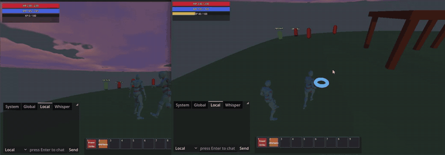
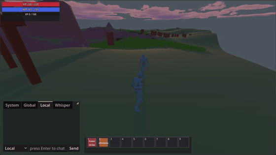
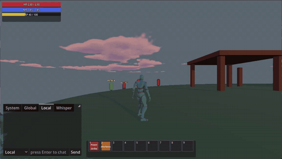

# QA-04 – Darstellung anderer Spieler: Drehung und Laufanimation

> **Dokumenttyp: Historisch rekonstruierte Fallstudie**
> Dass ich diesen Test selbst durchgeführt habe, ist meine Eigenangabe. Gestützt wird sie durch eigene Bildschirmaufnahmen von meinem Rechner vom 10.09.2026: Sie zeigen den Zustand vor der Korrektur, den Testaufbau mit zwei Clients und den Zustand danach. Ein schriftliches Testprotokoll oder einen Eintrag in der Projektdokumentation gibt es nicht. Die Korrektur ist in der Projekthistorie belegt (10.09.2026, 12:52 Uhr).

| Feld | Inhalt |
|---|---|
| Case-ID | QA-04 |
| Zeitraum | 10.09.2026; Aufnahmen um 01:50, 12:28 und 12:50 Uhr |
| Betroffene Funktion | Darstellung anderer Spieler im Mehrspielerbetrieb: Blickrichtung, Lauf- und Idle-Animation, später Angriffe; außerdem der Sprung |
| Technische Voraussetzungen | Lokaler Server, zwei Clients auf demselben Rechner, zwei Spielfiguren |
| Getestete Version | Nicht protokolliert |
| Schweregrad (eigene Einschätzung) | Hoch für ein MMORPG: Andere Spieler sind ständig sichtbar |
| Häufigkeit | Vor der Korrektur nach meiner Erinnerung immer |
| Persönliche Beteiligung | Testaufbau mit zwei Clients, Beobachtung, Beschreibung, Korrektur per KI veranlasst, erneut geprüft |
| Aktueller Status | Korrektur umgesetzt. Stand 23.10.2026: AN-06, AN-07, CB-13 und MV-07 PASS |

## Testaufbau

Ich habe den Server lokal gestartet und den Client zweimal gestartet. So war ich mit zwei Figuren gleichzeitig im Spiel und konnte im einen Fenster beobachten, was die Figur im anderen Fenster tut. Für diese Prüfung brauchte ich keinen zweiten Tester.

*Eigene Aufnahme vom 10.09.2026, 12:28 Uhr, auf die beiden Spielfenster zugeschnitten. Links Client 1, rechts Client 2; in jedem Fenster ist die Figur des anderen Clients zu sehen.*

## Reproduktion

1. Lokalen Server starten.
2. Client 1 und Client 2 starten, jeweils mit einer eigenen Figur einloggen.
3. Beide Figuren in Sichtweite bringen.
4. In Client 2 die Figur drehen, laufen und stehen bleiben lassen.
5. In Client 1 beobachten.

## Erwartetes Ergebnis

Client 1 zeigt die Figur aus Client 2 mit derselben Blickrichtung, mit Laufanimation während der Bewegung und Idle im Stand.

## Beobachtetes Ergebnis

| Nr. | Beobachtung | Beleg |
|---|---|---|
| 1 | Drehte ein Spieler seine Figur, sah der andere Spieler die Drehung **nicht**. | Erinnerung |
| 2 | Die Animationen anderer Spieler wurden **nicht übertragen**: Sie bewegten sich ohne Laufanimation. | Aufnahme 01:50 Uhr |
| 3 | Der **Sprung** war im Code bereits eingebaut, funktionierte im Spiel aber zunächst nicht. | Erinnerung |

*Eigene Aufnahme vom 10.09.2026, 01:50 Uhr, rund elf Stunden vor der Korrektur. Die eigene Figur ist animiert; der andere Spieler wird ohne seine Animationen dargestellt.*

## Korrektur

Die Änderung vom 10.09.2026 (umgesetzt durch KI) leitet Laufanimation und Blickrichtung anderer Spieler aus ihrer sichtbaren Bewegung ab. Ein Sprung löst dabei keine Laufanimation aus.

Am selben Tag kam auch der Sprung ins Projekt. Laut meiner Erinnerung wurden Sprung, Drehung und Laufanimation anderer Spieler in einem gemeinsamen Durchgang korrigiert und anschließend zusammen geprüft.

## Ergebnisse späterer Prüfungen

*Eigene Aufnahme vom 10.09.2026, 12:50 Uhr, zwei Minuten bevor die Korrektur im Projekt gespeichert wurde. Beide Figuren laufen nebeneinander mit Laufanimation.*

- Laut meiner Erinnerung habe ich danach mit denselben zwei Clients erneut geprüft und anschließend weitere Abläufe getestet: Angriffsanimationen und gemeinsames Angreifen von Monstern. Version, Datum und Einzelergebnisse sind nicht protokolliert.
- Im Projekt gibt es außerdem eine automatisierte Prüfung für Angriffsanimationen anderer Spieler (nicht von mir).

## Wer hat was gemacht

| Wer | Beitrag |
|---|---|
| Ich | Testaufbau mit zwei Clients, Beobachtung, Aufnahmen vor und nach der Korrektur, Nachtest (laut Eigenangabe allein durchgeführt) |
| Ich und Projektpartner | Korrektur der fehlenden Laufanimation gemeinsam veranlasst (nach meiner Erinnerung) |
| Projektpartner | Anfängliche Verbindungsprobleme zum Server behoben |
| KI (Claude Code / Codex) | Umsetzung der Korrektur |

## Grenzen der Nachweisbarkeit

- Die fehlenden Animationen, der Testaufbau und der Zustand nach der Korrektur sind mit Aufnahmen belegt. Die fehlende Drehung und das Sprungproblem beruhen auf meiner Erinnerung.
- Ob Drehung und Laufanimation nacheinander oder gemeinsam korrigiert wurden, lässt sich nicht trennen; belegt ist eine gemeinsame Änderung vom 10.09.2026.
- Verhalten unter Netzwerkverzögerung oder Paketverlust ist nicht geprüft. Das ist auch in den Projektanforderungen noch offen.

Als ausführbare Testfälle: [AN-06 und AN-07](../test-cases/animation-test-cases.md).
