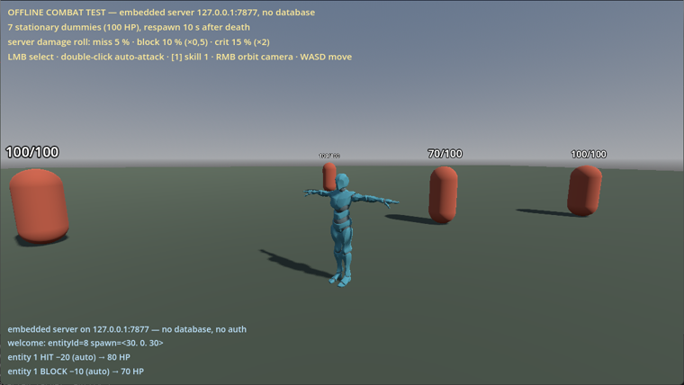
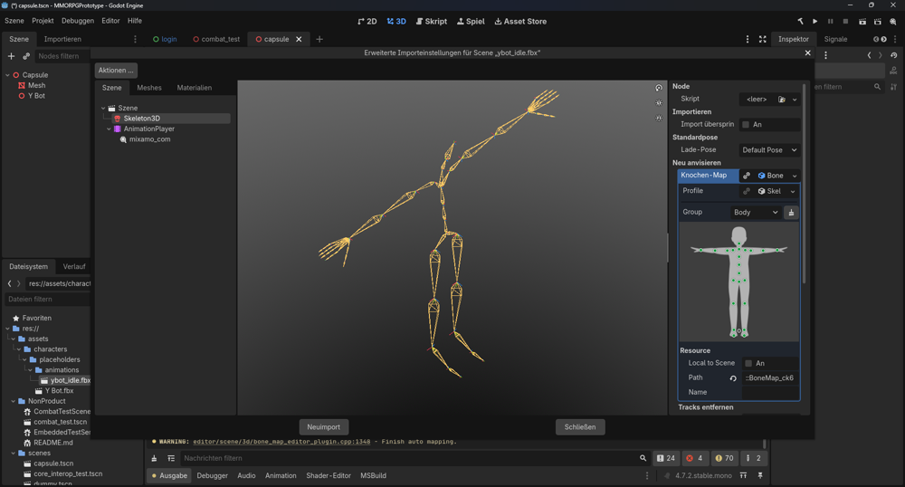
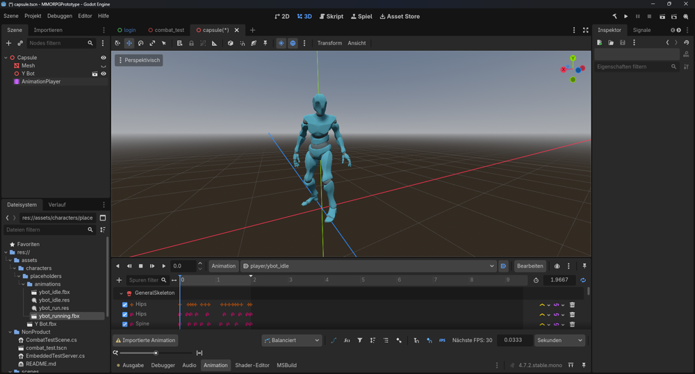
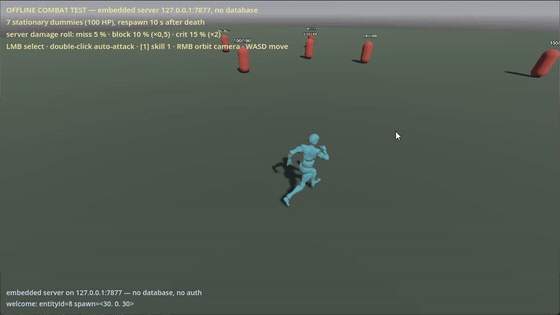
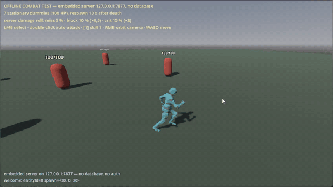

# QA-05 – Laufanimation: Figur springt immer wieder zurück

> **Dokumenttyp: Original belegter Qualitätsbefund**
> Fehler und Behebung sind mit meinen eigenen Bildschirmaufnahmen vom 29.08.2026 belegt (22:43 und 22:59 Uhr). Diesen Fall habe ich selbst gefunden und selbst behoben, ohne Claude Code oder Codex, mit einer Schritt-für-Schritt-Anleitung von ChatGPT.

| Feld | Inhalt |
|---|---|
| Case-ID | QA-05 |
| Datum | 29.08.2026, Fehler um 22:43 Uhr aufgenommen, Behebung um 22:59 Uhr |
| Betroffene Funktion | Laufanimation der Spielfigur |
| Technische Voraussetzungen | Offline-Kampftest im Godot-Client; Platzhalterfigur „Y Bot“ mit Animationen von Mixamo (Adobe) |
| Schweregrad (eigene Einschätzung) | Mittel – das Spiel lief, aber die Bewegung sah bei jedem Schritt falsch aus |
| Häufigkeit | Immer beim Laufen |
| Persönliche Beteiligung | Animationen selbst in Godot eingebunden, Fehler erkannt, Ursache eingegrenzt, Animation selbst ausgetauscht, erneut geprüft |
| Aktueller Status | Behoben. Laufen ist heute Teil der bestandenen Testfälle [AN-02](../test-cases/animation-test-cases.md) und [MV-01](../test-cases/movement-test-cases.md) |

## Vorgeschichte: die Figur bekommt Animationen

Am Abend des 29.08.2026 habe ich die graue Kapsel durch die Platzhalterfigur „Y Bot“ ersetzt und ihre Animationen in Godot eingebunden. Ich wollte selbst sehen, wie das in der Engine funktioniert. Die Schritte habe ich mir von ChatGPT erklären lassen und selbst im Editor ausgeführt.

| 1. Figur im Spiel, noch ohne Animation | 2. Knochen der Animation zuordnen | 3. Idle-Animation läuft im Editor |
|---|---|---|
|  |  |  |

*Eigene Bildschirmfotos vom 29.08.2026, 21:35–22:34 Uhr.*

## Reproduktion

1. Offline-Kampftest starten.
2. Mit WASD einige Sekunden geradeaus laufen.
3. Die Figur von hinten beobachten.

## Erwartetes Ergebnis

Die Figur läuft gleichmäßig mit der Bewegung mit. Die Laufanimation bewegt nur Arme und Beine, die Position bestimmt das Spiel.

## Beobachtetes Ergebnis

Die Figur lief der tatsächlichen Position voraus und **sprang dann immer wieder ruckartig zurück**. Insgesamt wirkte sie schneller als die eigentliche Bewegung.

*Eigene Aufnahme, 29.08.2026, 22:43 Uhr: Die Figur ruckt bei jedem Animationsdurchlauf nach vorne und zurück.*

## Ursache

Mixamo bietet Laufanimationen in zwei Varianten an:

| Variante | Verhalten |
|---|---|
| Mit Vorwärtsbewegung | Die Animation selbst bewegt die Figur nach vorne |
| „In Place“ (auf der Stelle) | Die Figur läuft auf der Stelle; die Bewegung kommt vom Spiel |

Eingebunden war die Variante **mit** Vorwärtsbewegung. Das Spiel bewegte die Figur also zweimal nach vorne: einmal über die Spielposition und einmal über die Animation. Am Ende jedes Animationsdurchlaufs sprang die Figur auf ihre tatsächliche Position zurück.

## Behebung

Ich habe die Laufanimation gegen die „In Place“-Variante ausgetauscht.

*Eigene Aufnahme, 29.08.2026, 22:59 Uhr, 16 Minuten später: gleichmäßiges Laufen ohne Zurückspringen.*

## Grenzen der Nachweisbarkeit

- Die Schritte zum Einbinden kamen von ChatGPT; ausgeführt habe ich sie selbst. Eigenen Programmcode habe ich dabei nicht geschrieben.
- Die Animationen sind Platzhalter von Mixamo (Adobe), keine eigenen Animationen.
- Im Projektverlauf wurden die Änderungen am 30.08.2026 zusammen mit weiteren, KI-gestützten Verbesserungen an Bewegung und Kampf gespeichert.

## Was dieser Fall zeigt

Das Fehlerbild „läuft zu schnell und springt zurück“ klingt nach einem Programmierfehler. Die Ursache lag aber in der verwendeten Animationsdatei. Ich habe den Fehler erkannt, auf eine Ursache eingegrenzt, gezielt behoben und das Ergebnis sofort mit einer zweiten Aufnahme geprüft.
