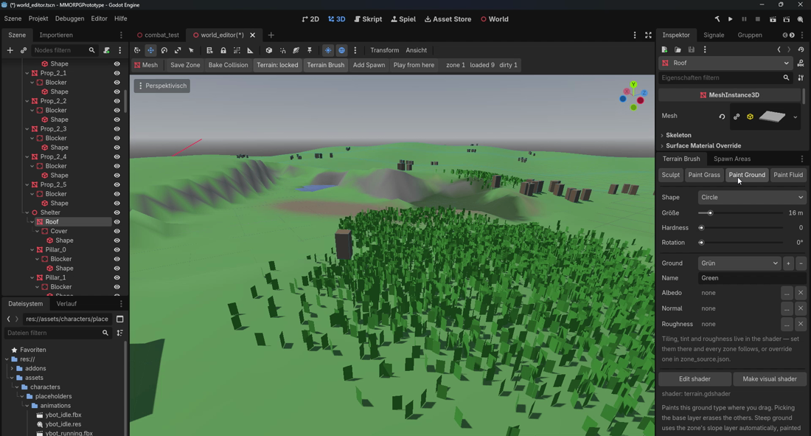
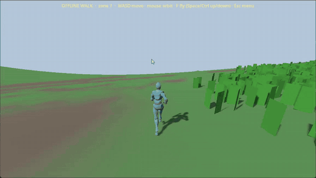

# Mein manueller Testablauf

Dieses Dokument beschreibt, wie ich im Projekt tatsächlich arbeite – und wo sich das von einem professionellen QA-Prozess unterscheidet.

## Der Ablauf

| Schritt | Was ich mache | Beispiel aus dem Projekt |
|---|---|---|
| 1. Idee entwickeln | Eine Mechanik aus Spielersicht beschreiben | „Gegner auswählen, ohne sofort anzugreifen“ |
| 2. Verhalten definieren | Festlegen, was passieren soll – möglichst als prüfbare Aussage | „Ein Klick wählt aus, ein Doppelklick greift an“ |
| 3. KI beauftragen | Beschreibung an Claude Code oder Codex geben | Umsetzung im Client |
| 4. Im Spiel testen | Funktion selbst ausprobieren, auch mit ungewöhnlichen Eingaben | Schnell klicken, während des Laufens angreifen |
| 5. Auffälligkeit erkennen | Abweichung vom erwarteten Verhalten bemerken | Angriff startet nicht zuverlässig |
| 6. Bedingungen eingrenzen | Herausfinden, wann es passiert und wann nicht | Nur bei schnellen Klicks? Nur in Bewegung? |
| 7. Beobachtung formulieren | Erwartung und tatsächliches Verhalten für die KI beschreiben | Erwartet / beobachtet / Umstände |
| 8. Korrektur umsetzen lassen | KI ändert den Code | Neue Doppelklick-Erkennung |
| 9. Erneut prüfen | Denselben Ablauf noch einmal spielen | Gleiche Klickfolge wiederholen |
| 10. Bewerten | Entscheiden: gut, Nacharbeit nötig oder anderer Ansatz | Weiterarbeit freigeben oder stoppen |

Am deutlichsten belegt ist dieser Ablauf in [QA-01](../bug-reports/01-visual-quality-review.md): Prüfung → Beanstandung mit Bildern → Neubewertung → Ursachenklärung → Entscheidung für einen neuen Ansatz.

## Was davon professionell ist – und was nicht

| Professioneller QA-Prozess | Mein bisheriger Ablauf |
|---|---|
| Testfälle vor dem Test schriftlich festgelegt | Erwartetes Verhalten stand meist in den Anforderungen, eigene Testfälle hatte ich bis Oktober 2026 nicht |
| Jede Ausführung protokolliert (Version, Datum, Ergebnis) | Meine frühen Tests sind nicht protokolliert |
| Bugreport in einem Tracker mit Status | Fehler wurden im Gespräch mit der KI beschrieben und direkt korrigiert |
| Definierte Regressionstests nach jeder Änderung | Nachtest des betroffenen Ablaufs, aber ohne feste Testliste |
| Schweregrad und Priorität nach festen Regeln | Einschätzung aus Spielersicht, noch ohne feste Skala |
| Getrennte Rollen: Entwicklung und Test | Ich beschreibe, die KI setzt um, ich prüfe – aber ohne festen Abnahmeprozess für Gameplay |

Dieses Portfolio ist mein erster Schritt, das zu ändern: Die [Testfälle](../test-cases/combat-test-cases.md) sind so formuliert, dass sie mit Version, Datum und Ergebnis ausgeführt werden können.

## Auch Werkzeuge testen

Nicht nur das Spiel selbst wird getestet. Mein Projektpartner hat einen World-Editor gebaut, mit dem Gelände, Bewuchs und Spielobjekte einer Zone bearbeitet werden. Nachdem er ihn eingebaut hatte, habe ich ihn am 02.09.2026 ausprobiert. Ich wollte herausfinden, was fehlt und was noch nicht gut funktioniert, damit er gezielt weiterarbeiten konnte. Dazu gehörte auch, die bearbeitete Zone direkt aus dem Editor heraus zu Fuß zu erkunden.

*Eigene Aufnahme vom 02.09.2026: der World-Editor beim Bemalen des Geländes.*

*Eigene Aufnahme vom 02.09.2026: mit der Spielfigur durch die bearbeitete Zone laufen.*

Meine einzelnen Rückmeldungen aus diesem Test sind nicht schriftlich festgehalten.

## Vorlage für künftige Testausführungen

So will ich jede Ausführung eines Testfalls künftig festhalten:

| Feld | Beispiel (Format, keine echten Werte) |
|---|---|
| Testfall-ID | CB-06 |
| Datum | TT.MM.JJJJ |
| Version / Stand | Commit-Kennung oder Build-Nummer |
| Umgebung | Offline-Testszene oder lokaler Server, Betriebssystem |
| Tester | Name |
| Ergebnis | PASS / FAIL / BLOCKED |
| Actual Result | Was tatsächlich passiert ist, in Schritten |
| Belege | Screenshot oder kurze Aufnahme |
| Folgeaktion | Bugreport-ID oder „keine“ |

## Was ich daraus gelernt habe

- **Ohne Protokoll kein Nachweis.** Meine frühen Tests kann ich heute vor allem über Bildschirmaufnahmen belegen, nicht über Notizen.
- **Aufnahmen vor und nach einer Korrektur sind der stärkste Beleg.** Siehe [QA-04](../bug-reports/04-remote-player-display.md) und [QA-05](../bug-reports/05-run-animation-root-motion.md).
- **„Technisch bestanden“ heißt nicht „sieht richtig aus“.** Siehe QA-01.
- **Den Prüfaufbau mitbeschreiben.** Ein Teil meiner Beanstandung in QA-01 kam von der Testpose, nicht vom Modell.
- **Grenzfälle sind die interessanten Fälle.** Probleme zeigten sich bei schnellen Eingaben und bei Zustandswechseln (Bewegung ↔ Angriff), nicht beim einfachen Normalfall.
- **Ein früherer Test gilt nicht für einen späteren Stand.** Nach einer Änderung muss erneut geprüft werden.

## Was ich als Nächstes lernen möchte

- Bugreports und Testfälle in einem Werkzeug wie Jira oder TestRail führen
- Regressionstests planen: Welche Fälle nach welcher Änderung?
- Testsitzungen mit mehreren Spielern koordinieren
- Testumgebungen aufsetzen und Netzwerkbedingungen gezielt simulieren
- Grundlagen von Linux und automatisierten Tests, um mit Entwicklern besser zusammenzuarbeiten
